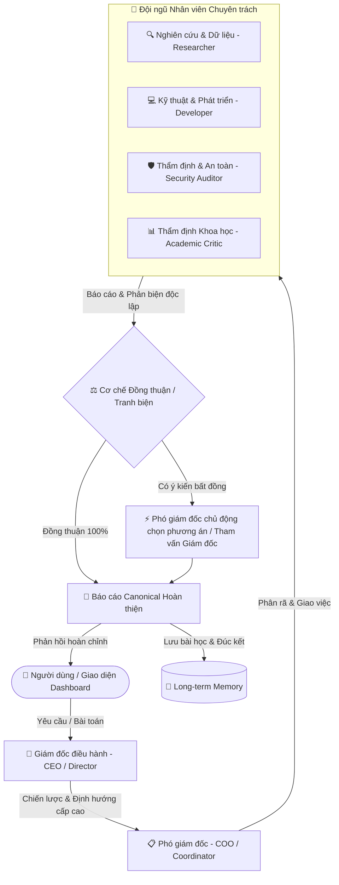

# 🚀 CYBER AGENT PRO // MULTI-AGENT AUTONOMOUS SYSTEM

> **Hệ thống AI Đa Tác Nhân (Hierarchical Multi-Agent Framework) tự học, phân tích chuyên sâu, phản biện đa chiều và tích lũy trí nhớ dài hạn.**

[](https://nodejs.org/)
[](https://expressjs.com/)
[](https://pptr.dev/)
[](https://ai.google.dev/)
[](https://opensource.org/licenses/ISC)

---

## 📖 1. Giới thiệu tổng quan

**Cyber Agent Pro** là một nền tảng AI Agent tự hành được thiết kế theo mô hình tổ chức doanh nghiệp hiện đại. Thay vì để một mô hình ngôn ngữ lớn (LLM) đơn lẻ xử lý mọi yêu cầu, hệ thống phân rã tác vụ phức tạp thành một quy trình làm việc chuyên nghiệp giữa các cấp quản lý và các nhân viên chuyên trách, đảm bảo tính chính xác, tính phản biện học thuật và độ tin cậy cao nhất.

### 🌟 Điểm nổi bật:
- 🏛️ **Cấu trúc phân cấp lãnh đạo:** Mô phỏng tổ chức thực tế với Giám đốc (CEO/Director), Phó giám đốc (COO/Coordinator) và các Agent chuyên trách.
- ⚖️ **Cơ chế phản biện & Đồng thuận (Consensus & Debate Protocol):** Các Agent nhân viên độc lập đánh giá, thảo luận và phản biện đa chiều; Phó giám đốc điều phối và đưa ra quyết định xử lý khi có bất đồng.
- 🧠 **Trí nhớ dài hạn & Tự tiến hóa (Self-Learning Long-Term Memory):** Tự động đúc kết kinh nghiệm sau mỗi lần thực thi (`experiences.json` & `EXPERIENCES.md`), tránh lặp lại sai lầm trong quá khứ.
- 🌐 **Thu thập dữ liệu web tự động (Stealth Automation):** Trình duyệt không đầu (Headless Browser) qua Puppeteer Stealth giúp tra cứu tài liệu thực tế theo thời gian thực mà không bị chặn bot.
- 🛡️ **Cơ chế an toàn mã nguồn:** Hệ thống kiểm soát bảo mật đường dẫn (Path Traversal Protection) và tự động tạo snapshot dự phòng cục bộ khi chỉnh sửa tài nguyên.

---

## 🏛️ 2. Kiến trúc Đa Tác Nhân (Multi-Agent Architecture)



### Chi tiết các vai trò:
1. **Giám đốc điều hành (CEO):** Nhận đề bài từ người dùng, thẩm định yêu cầu, xác định chiến lược tổng quát và giám sát chất lượng sản phẩm đầu ra.
2. **Phó giám đốc (COO):** Cánh tay phải điều hành tác nghiệp, phân rã mục tiêu lớn thành các tác vụ con, phân bổ việc cho đúng nhân viên chuyên trách, điều phối tranh luận và đưa ra quyết định khi các nhân viên có góc nhìn trái ngược.
3. **Các Agent chuyên môn:** 
   - **Scientific Researcher:** Thu thập bằng chứng thực nghiệm, tài liệu học thuật (DOI, PMID).
   - **Code Specialist:** Thiết kế giải pháp kỹ thuật, viết mã nguồn tối ưu.
   - **Quality & Security Critic:** Rà soát lỗ hổng, kiểm chứng độ trung thực tri thức (loại bỏ ngụy khoa học).
4. **Hệ thống Trí nhớ (Long-Term Memory):** Ghi nhớ các giải pháp đã thành công và các bài học thất bại để hệ thống ngày càng thông minh hơn qua từng phiên làm việc.

---

## 📁 3. Cấu trúc thư mục dự án

```text
AI agent/
├── index.html                       # Giao diện Dashboard điều khiển hiện đại
├── server.js                        # Máy chủ điều phối trung tâm (Express 5.x)
├── start.bat                        # File khởi động nhanh một chạm trên Windows
├── package.json                     # Thông tin gói và thư viện phụ thuộc
├── .gitignore                       # Danh sách loại trừ tệp nhạy cảm & cache
│
├── memory/                          # 🧠 Bộ não trí nhớ dài hạn của AI
│   ├── experiences.json             # Cơ sở dữ liệu tri thức tích lũy (JSON)
│   ├── EXPERIENCES.md               # Nhật ký bài học kinh nghiệm chi tiết
│   ├── claim_ledger.json            # Sổ cái kiểm chứng các tuyên bố khoa học
│   └── research/                    # Tài liệu chuyên sâu do AI tự nghiên cứu
│
├── middleware/                      # Các tầng lọc bảo mật trung gian
│   └── pathSecurity.js              # Chặn Path Traversal, bảo vệ hệ thống tệp
│
├── utils/                           # Các mô-đun tiện ích hỗ trợ
│   ├── asyncMutex.js                # Khóa đồng bộ truy xuất bộ nhớ chống race-condition
│   └── validation.js                # Kiểm thực dữ liệu đầu vào
│
├── comprehensive_test_suite.js     # Bộ kịch bản kiểm thử tích hợp toàn diện
└── scientific_benchmark_harness.js  # Bộ kiểm thử chuẩn mực học thuật & phản biện
```

---

## ⚡ 4. Hướng dẫn cài đặt & Khởi chạy

### Điều kiện tiên quyết:
- **Node.js**: Phiên bản 18.0 trở lên ([Tải tại đây](https://nodejs.org/)).
- **Trình duyệt Google Chrome** (để hỗ trợ tính năng Web Automation qua Puppeteer).
- Khóa bí mật **Gemini API Key** ([Đăng ký miễn phí tại Google AI Studio](https://aistudio.google.com/)).

### Bước 1: Clone kho mã nguồn
```bash
git clone https://github.com/namoktin/graduation_project.git
cd "AI agent"
```

### Bước 2: Cài đặt các gói phụ thuộc
```bash
npm install
```

### Bước 3: Cấu hình biến môi trường
Tạo một file có tên `.env` tại thư mục gốc với nội dung:
```ini
# Cấu hình cổng máy chủ
PORT=3000

# Khóa API Google Gemini (Bắt buộc)
GEMINI_API_KEY=your_actual_gemini_api_key_here

# Thư mục xuất sản phẩm (tùy chọn)
OUTPUT_DIR=C:\Users\YourUser\Desktop\gemini

# Cấu hình AI tùy chỉnh (tùy chọn nếu dùng Local LLM/Claude)
# CUSTOM_AI_BASE_URL=https://api.openai.com/v1
# CUSTOM_AI_MODEL=gpt-4o
# CUSTOM_AI_KEY=your_custom_key_here
```

### Bước 4: Khởi động hệ thống
Bạn có thể khởi động theo 1 trong 2 cách:

- **Cách 1 (Nhanh nhất trên Windows):** Click đúp chuột vào file `start.bat`. Hệ thống sẽ tự động bật server và mở trình duyệt tại `http://localhost:3000`.
- **Cách 2 (Qua dòng lệnh Terminal/PowerShell):**
  ```bash
  npm start
  ```
  Sau đó mở trình duyệt truy cập: `http://localhost:3000`.

---

## 🧪 5. Kiểm thử hệ thống (Automated Testing)

Dự án được trang bị sẵn các bộ kiểm thử chuyên sâu nhằm đảm bảo tính ổn định và chuẩn mực học thuật:

```bash
# Chạy bộ kiểm thử tích hợp hồi quy toàn diện (Regression & Integration Test):
node comprehensive_test_suite.js

# Chạy bộ đo lường chuẩn mực khoa học & phản biện (Scientific Benchmark):
node scientific_benchmark_harness.js
```

---

## 🛡️ 6. An toàn & Bảo mật

- **Không đưa file `.env` lên Git:** File `.env` chứa các API Key riêng tư. File này đã được thêm vào `.gitignore` để đảm bảo an toàn tuyệt đối.
- **Cách ly dữ liệu người dùng:** Thư mục `chrome_profile/` và các tệp snapshot cục bộ `.snapshots/` được bảo vệ độc quyền trên môi trường local, không chia sẻ lên repo công khai.
- **Phòng vệ Path Traversal:** Mọi thao tác đọc/ghi file từ Agent đều đi qua bộ lọc kiểm tra an toàn, ngăn chặn việc can thiệp ra ngoài phạm vi thư mục cho phép.

---

## 📄 7. Giấy phép (License)

Dự án được phân phối dưới giấy phép [ISC License](LICENSE).
Mọi đóng góp, báo lỗi (Issues) hoặc yêu cầu tính năng (Pull Requests) đều được hoan nghênh!

