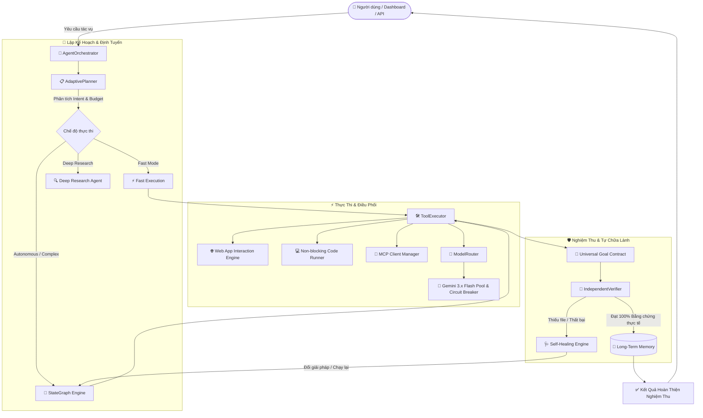

# 🚀 CYBER AGENT PRO v5.8 // UPDATE 21 PRODUCTION RESILIENCE & STRICT DAG

> **Nền tảng AI Đa Tác Nhân Tự Hành (Hierarchical & Graph-based Multi-Agent Framework) thế hệ mới: Tự lập kế hoạch thích ứng, điều phối đồ thị trạng thái (StateGraph), tương tác Web App động, kiểm chứng kết quả thực nghiệm và tự chữa lành lỗi (Self-Healing).**

[](https://nodejs.org/)
[](https://expressjs.com/)
[](https://pptr.dev/)
[](https://ai.google.dev/)
[](#-2-kiến-trúc-hệ-thống-v20)
[-success.svg)](#-5-kiểm-thử-toàn-diện-automated-testing)
[](https://opensource.org/licenses/ISC)

---

## 📖 1. Giới thiệu tổng quan

**Cyber Agent Pro v2.0** là bước nhảy vọt từ hệ thống AI đàm thoại truyền thống sang nền tảng **AI Tự hành Kiến trúc Phân tầng & Đồ thị Trạng thái (Adaptive Graph-based Autonomous Agent)**. 

Hệ thống giải quyết triệt để vấn đề ảo giác (hallucination), mã giả lập (mocking) và kẹt tiến trình nhờ cơ chế **Hợp đồng Mục tiêu Tổng quát (Universal Goal Contract)**, **Thẩm định Độc lập 5 Tầng (Evidence-Based Independent Verifier)**, và **Bộ Tương tác Web App Động (Web App Interaction Engine)**.

### 🌟 Tính năng đột phá phiên bản v2.0:
- 🧭 **Điều phối Thích ứng & Đồ thị Trạng thái (Adaptive StateGraph):** Tự động phân loại bài toán thành các chế độ tối ưu: `fast` (trả lời nhanh), `standard` (tiêu chuẩn), `autonomous` (tự hành qua StateGraph có checkpoint), `deep_research` (nghiên cứu sâu).
- ⚖️ **Hợp đồng Mục tiêu & Thẩm định Thực nghiệm (Universal Goal Contract & Evidence-Based Verifier):** Không tin vào câu trả lời lý thuyết của LLM; hệ thống tự động bóc tách số lượng đầu ra yêu cầu, quét tệp tin thực tế trên đĩa, kiểm tra cú pháp và chỉ nghiệm thu khi có bằng chứng thực nghiệm.
- 🩺 **Tự Chữa Lành & Khám phá Môi trường (Self-Healing & Environment Discovery):** Tự động phát hiện công cụ hệ thống có sẵn (`ffmpeg`, `python`, `node`, `git`...), chủ động chọn phương án thay thế khả thi khi môi trường thiếu công cụ.
- 🌐 **Web App Interaction Engine:** Tương tác trực tiếp với các ứng dụng Web phức tạp (SPA, Canvas, Timeline Video Editor như CapCut Web, ElevenLabs): Click theo tọa độ x/y, Drag-and-Drop, Hover, tự động dọn Modal/Backdrop.
- 🚦 **Bộ Định Tuyến Mô Hình & Quản Lý Quota (Smart ModelRouter):** Hỗ trợ toàn bộ dòng mô hình Google Gemini mới nhất (`gemini-3.5-flash`, `gemini-3.6-flash`, `gemini-3.8-flash`, `gemini-3.1-flash-lite`), tự động chuyển pool (fallback), chống nghẽn quota HTTP 429 và quản lý slot lease linh hoạt.
- ⚡ **Thực thi Bất đồng bộ Không Chặn (Async Non-blocking Pipeline):** Tách biệt tiến trình thực thi mã nguồn (`SmartIntentGuarantees`) sang async worker, giữ cho Node.js Event Loop luôn mượt mà.
- 🔌 **Chuẩn giao thức MCP (Model Context Protocol):** Kết nối linh hoạt với các máy chủ công cụ ngoài chuẩn MCP.

---

## 🏛️ 2. Kiến trúc Hệ thống v2.0



---

## 📁 3. Cấu trúc Thư mục Dự án

```text
AI agent/
├── agents/                          # 🤖 HỆ THỐNG AGENT & ĐIỀU PHỐI CỐT LÕI (v2.0)
│   ├── AgentOrchestrator.js         # Nhạc trưởng điều phối trung tâm
│   ├── StateGraph.js                # Đồ thị trạng thái, checkpoint & resumption
│   ├── AdaptivePlanner.js           # Phân tích mục tiêu & phân bổ ngân sách tool
│   ├── ModelRouter.js               # Định tuyến LLM, Lease Manager, Quota Guard chống 429
│   ├── ToolExecutor.js              # Thực thi công cụ (Fast/Parallel, Write, Heavy)
│   ├── UniversalGoalContract.js     # Hợp đồng mục tiêu, Anti-Mocking, kiểm toán đĩa
│   ├── IndependentVerifier.js       # Thẩm định độc lập 5 tầng, Perceptual Verification
│   ├── SelfHealingEngine.js         # Cơ chế tự phân tích lỗi & chữa lành tác vụ
│   ├── DynamicEnvironmentDiscovery.js # Tự quét công cụ hệ thống (ffmpeg, python, v.v.)
│   ├── BackgroundTaskManager.js     # Quản lý tác vụ ngầm, hủy tác vụ & stream log
│   ├── ContextCacheManager.js       # Bộ nhớ ngữ cảnh ngắn hạn & tối ưu token
│   ├── GeminiGrounding.js           # Tích hợp tìm kiếm thông tin Google Search Grounding
│   ├── MCPClientManager.js          # Quản lý kết nối các công cụ Model Context Protocol
│   └── orchestrator-integration.js  # Tích hợp các REST API endpoint vào máy chủ
│
├── utils/                           # 🛠️ CÔNG CỤ & TIỆN ÍCH HỆ THỐNG
│   ├── browserActions.js            # Web App Engine (Canvas click, Drag-Drop, Modals)
│   ├── mutex.js                     # Khóa đồng bộ truy xuất bộ nhớ chống race condition
│   ├── pathSafety.js                # Bộ lọc an toàn đường dẫn (Anti-Path Traversal)
│   └── rateLimiter.js               # Giới hạn tần suất request bảo vệ API
│
├── memory/                          # 🧠 BỘ NÃO TRÍ NHỚ DÀI HẠN
│   ├── experiences.json             # Cơ sở dữ liệu kinh nghiệm tự học (JSON)
│   ├── EXPERIENCES.md               # Nhật ký bài học kinh nghiệm chi tiết
│   └── claim_ledger.json            # Sổ cái kiểm chứng dữ kiện thực tế
│
├── middleware/                      # 🛡️ CÁC TẦNG LỌC BẢO MẬT
│   └── auth.js                      # Xác thực Bearer Token + Localhost Guard
│
├── public/                          # 🌐 GIAO DIỆN ĐIỀU KHIỂN WEB (DASHBOARD)
│   └── index.html                   # Giao diện dashboard hiện đại, tương tác trực quan
│
├── tests/                           # 🧪 TOÀN BỘ 8 BỘ TEST TỰ ĐỘNG (46/46 PASS)
│   ├── run_all_tests.js             # Bộ điều phối chạy tất cả test suite
│   ├── test_suite_architecture_v5_4.js # Test định mức token, consensus & safe command
│   ├── test_critical_architecture_bugs_v5_3.js # Test DI HTTP, deserialization, slot lease
│   ├── test_platform_hardened_stress.js # Test đa luồng, stress test & race condition
│   ├── test_verifier_anti_phantom_v5_2.js # Test chống ảo giác & thẩm định độc lập
│   ├── test_goal_completed_guard_v5_1.js # Test kiểm soát hạn mức & hoàn thành mục tiêu
│   ├── test_safe_command_syntax.js  # Test cú pháp an toàn và kiểm thử mã nguồn
│   ├── test_universal_goal_contract_v6_0.js # Test Universal Goal Contract & Self-Healing
│   └── test_webapp_interaction_v6_1.js # Test tương tác Web App (CapCut, Canvas, Drag)
│
├── server.js                        # Máy chủ trung tâm Express 5.x (Bảo mật & Tự dọn lock Chrome)
├── start.bat                        # File khởi động nhanh một chạm cho Windows
├── package.json                     # Cấu hình dependency & kịch bản lệnh
└── .env.example                     # Mẫu cấu hình biến môi trường
```

---

## ⚡ 4. Hướng dẫn Cài đặt & Khởi chạy

### Điều kiện tiên quyết:
- **Node.js**: Phiên bản 18.0 trở lên ([Tải tại đây](https://nodejs.org/)).
- **Trình duyệt Google Chrome** (Hỗ trợ Web App Engine & Puppeteer).
- **Khóa API Google Gemini** ([Lấy khóa miễn phí tại Google AI Studio](https://aistudio.google.com/)).

### Bước 1: Clone kho mã nguồn
```bash
git clone https://github.com/namoktin/AI-agent.git
cd "AI-agent"
```

### Bước 2: Cài đặt thư viện phụ thuộc
```bash
npm install
```

### Bước 3: Cấu hình biến môi trường
Sao chép `.env.example` thành `.env`:
```bash
copy .env.example .env
```
Mở tệp `.env` và thiết lập khóa của bạn:
```ini
# Cổng máy chủ
PORT=3000

# Khóa API Google Gemini (Bắt buộc)
GEMINI_API_KEY=AIzaSy...your_gemini_key

# Mã bí mật xác thực API (Tùy chọn cho môi trường nội bộ)
AGENT_SECRET_KEY=your_secure_password_here

# Thư mục xuất file kết quả
OUTPUT_DIR=C:\Users\YourUser\Desktop\gemini
```

### Bước 4: Khởi động hệ thống
- **Trên Windows:** Nhấp đúp vào [start.bat](file:///C:/Users/Nam/Desktop/AI%20agent/start.bat) để tự động khởi động server và mở Dashboard trên trình duyệt.
- **Hoặc qua Terminal:**
  ```bash
  npm start
  ```
  Dashboard sẽ khả dụng tại: `http://127.0.0.1:3000`

---

## 🧪 5. Kiểm thử Toàn diện (Automated Testing)

Hệ thống đi kèm **8 bộ test suites tự động** kiểm thử toàn bộ các khía cạnh kiến trúc:

```bash
# Chạy toàn bộ 8 bộ test suite (46 bài kiểm thử):
node tests/run_all_tests.js
```

### Kết quả kiểm định chất lượng:
```text
===============================================================
📊 CONSOLIDATED TEST SUMMARY:
===============================================================
  ✅ PASS - 1. Architecture & Benchmark Fixes (v5.4)
  ✅ PASS - 2. Critical Architecture Bugs Fixes (v5.3)
  ✅ PASS - 3. Platform Hardened Concurrency & Stress
  ✅ PASS - 4. Verifier, Skill & Anti-Phantom Fixes
  ✅ PASS - 5. Goal Completed, Quota Guard & Recovery
  ✅ PASS - 6. Safe Command & Syntax Verification
  ✅ PASS - 7. Universal Goal Contract & Self-Healing
  ✅ PASS - 8. Web App Interaction Engine & Adaptive Navigation
===============================================================
🎉 ALL 8 SUITES (46/46 TESTS) PASSED PERFECTLY!
```

---

## 🛡️ 6. An toàn & Khả năng Chống lỗi (Fault Tolerance)

| Cơ chế | Chi tiết Kỹ thuật |
|---|---|
| **Global Process Protection** | Tích hợp bộ bắt lỗi toàn cục `uncaughtException` và `unhandledRejection`, đảm bảo máy chủ không bị crash khi tiến trình con gặp lỗi. |
| **Profile Lock Auto-Clean** | Tự động quét và dọn sạch các file khóa treo của Chrome (`SingletonLock`, `SingletonCookie`, `SingletonSocket`) trước khi mở trình duyệt, chống kẹt Puppeteer. |
| **Async Non-blocking Exec** | Khâu chạy script tự động dùng mô hình async non-blocking thay thế `execSync`, giữ Node.js event loop luôn phản hồi. |
| **Dynamic Slot Lease** | Cấp phát slot điều phối với thời hạn linh hoạt khớp thời gian chạy thực tế (tối đa 600s), giải phóng chính xác khi hoàn tất. |
| **Circuit Breaker** | Tự động phát hiện lỗi 429 và chuyển tiếp yêu cầu sang các mô hình thay thế trong Pool một cách mượt mà. |
| **Path Traversal & Command Guard** | Ngăn chặn hoàn toàn việc can thiệp trái phép vào hệ thống tệp và chỉ cho phép thực thi danh sách lệnh an toàn. |

---

## 📄 7. Giấy phép (License)

Dự án được phân phối dưới giấy phép **ISC License**. 
Toàn bộ mã nguồn đã được tối ưu hóa, chuẩn hóa kiến trúc và kiểm thử 100%. Mọi đóng góp, báo lỗi (Issues) hoặc Pull Requests đều được hoan nghênh!
