# BÁO CÁO KIỂM TOÁN KIẾN TRÚC HIỆN TẠI (ARCHITECTURE AUDIT)
**Dự án:** Cyber Agent Pro Multi-Agent Platform  
**Phiên bản hiện tại:** v4.5 Enterprise  
**Thời điểm thực hiện:** 25/10/2026  
**Hội đồng thẩm định:** Principal AI Architect, Senior Node.js Engineer, Orchestration Specialist, LLM Performance Engineer, QA Engineer  

---

## 1. XÁC NHẬN TRẠNG THÁI HỆ THỐNG & GIT

- **Git Branch:** `main`
- **Git Commit SHA:** `90099c7` ("update 11")
- **Trạng thái Working Tree:** Clean (100% committed, không có uncommitted changes).
- **Môi trường chạy:** Node.js v22.21.0 on Windows.
- **Cấu hình mô hình hoạt động (.env):**
  - `GEMINI_MODEL=gemini-3.5-flash-lite`
  - `GEMINI_MODEL_FAST=gemini-flash-lite-latest`
  - `GEMINI_MODEL_STANDARD=gemini-3.5-flash-lite`
  - `GEMINI_MODEL_HEAVY=gemini-3.5-flash-lite`
  - Quota Free Tier của các model preview cũ (`gemini-3.1-flash-lite`, `gemini-3.8-flash`, `gemini-3.6-flash`) đã chạm ngưỡng 20 hoặc 500 RPD; cặp model `gemini-3.5-flash-lite` và `gemini-flash-lite-latest` hoạt động ổn định (HTTP 200).

---

## 2. KẾT QUẢ KIỂM THỬ XÁC LẬP BASELINE (PRE-UPGRADE BASELINE)

Toàn bộ 4 bộ test suites hiện hành đều đạt trạng thái **100% PASS**:
1. `test_v4_5_enterprise_upgrades.js`: **7/7 PASS** (Quota Scheduler inflight queue, Physical Acceptance Gate, Auto-Resume Checkpoint, Strategy Selection).
2. `test_all_remaining_features.js`: **8/8 PASS** (Path Guard, CMD Blacklist, JS VM Sandbox, Cookie Vault, Gemini Grounding Fallback, File operations).
3. `test_audit_v4_3_issues.js`: **8/8 PASS** (Goal vs Process Completion, Optimal Strategy Keyword Routing, Circuit Breaker).
4. `test_e2e_new_features.js`: **7/7 PASS** (Crossref/DOI Validation, Dynamic Replan Graph, Skill Learning, API /api/v2/execute).
- **Tổng số test cases:** **30/30 PASS (100%)** — Không có hồi quy (Zero Regressions).

---

## 3. SƠ ĐỒ LUỒNG THỰC THI THỰC TẾ (RUNTIME FLOW)

```mermaid
flowchart TD
    Client["Client / Web UI / REST Client"] -->|POST /api/v2/execute| Server["server.js (Express)"]
    Server -->|Context Check & Experiences Load| Orchestrator["AgentOrchestrator.js"]
    
    subgraph S1["Stage 0 & 1: Warmup & Strategic Directive"]
        Orchestrator --> Warmup["Warmup Context Cache & Skill Match"]
        Warmup --> DirectorCall["Director Strategic Analysis (callAgent: director)"]
    end
    
    subgraph S2["Stage 2: Adaptive Planning"]
        DirectorCall --> AdaptivePlan["AdaptivePlanner.determineMode() & generatePlan()"]
        AdaptivePlan --> CoordinatorCall["Coordinator Task Refinement (or fallback to AdaptivePlan)"]
        CoordinatorCall --> CheckpointPlan["CheckpointManager.saveCheckpoint('coordinator')"]
    end
    
    subgraph S3["Stage 3: Specialist Execution"]
        CheckpointPlan --> TopoSort["topologicalSort(tasks)"]
        TopoSort --> BatchParallel["executeTasksParallel(batches)"]
        BatchParallel --> ModelDispatch["ModelRouter.acquireDispatchSlot()"]
        ModelDispatch --> GeminiAPI["Gemini API (generateContent)"]
        GeminiAPI --> ToolLoop["Multi-step Tool Calling (ToolExecutor.executeTools)"]
        ToolLoop --> ReplanCheck{"Any task failed?"}
        ReplanCheck -->|Yes| ReplanDAG["AdaptivePlanner.replan() & Recovery Tasks"]
        ReplanCheck -->|No| CheckpointSpec["CheckpointManager.saveCheckpoint('specialists')"]
        ReplanDAG --> CheckpointSpec
    end
    
    subgraph S4["Stage 4 & 4.5: Consensus & Enforced Remediation"]
        CheckpointSpec --> ConsensusCheck["achieveConsensus(specialistResults)"]
        ConsensusCheck -->|Achieved| VerifierGate
        ConsensusCheck -->|Failed| DirectorArb["Director Arbitration Directive"]
        DirectorArb --> RemediationSpecialist["Enforced Remediation Loop (Lead Specialist Tools Execution)"]
        RemediationSpecialist --> FileEmbed["Embed Created Physical Files Content"]
        FileEmbed --> VerifierGate
    end
    
    subgraph S5["Stage 5 & 6: Independent Verification & Final Gate"]
        VerifierGate["STAGE 5: IndependentVerifier.verifyExecution()"]
        VerifierGate --> PhysicalAudit["Physical File & Data Check"]
        PhysicalAudit --> CriticGate["STAGE 6: Critic Final Critique"]
        CriticGate --> CheckpointClear["CheckpointManager.clearCheckpoint()"]
        CheckpointClear --> Response["Return JSON Response & Auto-save Skill"]
    end
```

---

## 4. PHÂN LOẠI TÍNH NĂNG THEO TRẠNG THÁI THỰC TẾ

| Thành Phần / Tính Năng | Trạng Thái Thực Tế | Đánh Giá Chi Tiết |
|---|:---:|---|
| **AdaptivePlanner** | Đang Hoạt Động (Một phần) | Đã phân 4 modes (`fast`, `deep_research`, `autonomous`, `standard`) và dynamic replanning, nhưng task plan vẫn dạng danh sách tuyến tính/batch phụ thuộc, chưa phải State Graph có chu trình lặp điều kiện và state schema chặt chẽ. |
| **AgentOrchestrator** | Đang Hoạt Động | Chạy 6 giai đoạn, có fallback, có Enforced Specialist Remediation. Điểm nghẽn: luồng thực thi vẫn bám theo fixed stage pipeline thay vì Graph Engine điều khiển trạng thái tự do. |
| **ToolExecutor** | Đang Hoạt Động | Hỗ trợ 20+ tools native (Shell, File, Puppeteer, Scraper, Sandbox, Cookie). **Chưa có:** Chuẩn kết nối giao thức MCP (Model Context Protocol). |
| **ModelRouter (Quota Scheduler)** | Đang Hoạt Động (Cần nâng cấp V2) | Đã có hàng đợi pre-dispatch và sliding window RPM/TPM/RPD. **Lỗ hổng:** Còn dòng lệnh `Force granting slot` khi timeout 10s dẫn tới nguy cơ đục thủng quota; chưa trích xuất `retryDelay` động từ body 429 của Google. |
| **IndependentVerifier** | Đang Hoạt Động | Có kiểm tra vật lý tệp, đối soát Crossref DOI sống, chặn luận điểm retract/contradict. **Cần nâng cao:** Khả năng phân rã luận điểm thành claim-level evidence matching và phân loại `SUPPORTED`, `CONTRADICTED`, `INSUFFICIENT_EVIDENCE`. |
| **SkillLibrary** | Đang Hoạt Động | Đã có xếp hạng theo track-record `successRate` và tinh chỉnh từ khóa. **Cần nâng cấp:** Wilson score / Bayesian estimate cho kỹ năng mới; quy trình đầy đủ: tìm kỹ năng -> áp dụng -> đo lường -> cập nhật latency/token. |
| **BackgroundTaskManager** | Đang Hoạt Động | Đã phân tách `PROCESS_COMPLETED` vs `GOAL_COMPLETED`, kiểm tra dung lượng tệp và auto-resume. |
| **Real-time Streaming (SSE)** | **Chưa Tồn Tại** | Hệ thống hiện tại chỉ phản hồi HTTP Request/Response truyền thống một lần sau khi hoàn thành toàn bộ pipeline; chưa có endpoint Server-Sent Events (SSE) để truyền sự kiện thời gian thực. |
| **Human-In-The-Loop (HITL)** | **Chưa Tồn Tại** | Chưa có cơ chế tạm dừng `WAITING_APPROVAL`, lưu checkpoint chờ người dùng review và API `/api/v2/tasks/:taskId/approve` để tiếp tục. |
| **MCP Tool Ecosystem** | **Chưa Tồn Tại** | Chưa có module `MCPClientManager`, chưa hỗ trợ transport stdio / SSE / Streamable HTTP kết nối các MCP servers bên ngoài. |

---

## 5. CÁC ĐIỂM NGHẼN, LỖ HỔNG & NGUỒN TIÊU HAO TOKEN ĐƯỢC PHÁT HIỆN

1. **Lỗ hổng cưỡng bức cấp slot (Force Granting Slot):**
   - Vị trí: `ModelRouter.js` line 133: `console.warn('... Force granting slot')`.
   - Vấn đề: Khi chờ quá 10s trong hàng đợi, hệ thống tự động cấp quyền gọi API bất chấp quota. Nếu nhiều agent đồng thời gọi trong thời điểm token bucket cạn, lệnh cưỡng bức này trực tiếp gây ra HTTP 429.
   - Giải pháp V2: Bỏ hoàn toàn force grant; thay bằng cơ chế backoff có jitter, đổi sang model còn quota hoặc tạm dừng task có checkpoint.
2. **Thiếu trích xuất `retryDelay` từ phản hồi HTTP 429:**
   - Khi Gemini trả về HTTP 429, body JSON luôn chứa thông tin chính xác: `"retryDelay": "46.89s"` hoặc `"retryDelay": "57463s"`.
   - Hiện tại hệ thống đang hardcode cooldown 60s, dẫn đến 2 trường hợp tai hại:
     - Model chỉ cần nghỉ 5-10s thì bị khóa oan 60s.
     - Model bị cạn quota ngày (cần chờ 16 tiếng) thì sau 60s lại gọi tiếp gây lỗi liên hoàn.
3. **Tiêu hao token do lặp lại các bước không idempotent:**
   - Trong quá trình Dynamic Replanning hoặc Retries, một số công cụ ghi đĩa hoặc truy vấn web bị gọi lại dù trước đó đã có kết quả hợp lệ.
   - Giải pháp: StateGraph cần trang bị Idempotency Guard và Output Caching cho từng node.
4. **Thiếu cơ chế Streaming tiến độ khiến Client tưởng treo:**
   - Các tác vụ phức tạp kéo dài 60 - 150 giây khiến client không biết hệ thống đang ở bước nào (Stage 1, 2, 3, Tool nào đang chạy, hay đang chờ Quota).
   - Cần bổ sung SSE Server-Sent Events phát các event có cấu trúc.

---

## 6. LỘ TRÌNH TRIỂN KHAI NÂNG CẤP (IMPLEMENTATION ROADMAP)

- **Bước 1:** Xây dựng `agents/StateGraph.js` — Stateful Graph Execution Engine hỗ trợ DAG + Conditional Loops + Node Retries + Idempotency Guard. Tích hợp vào `AdaptivePlanner.js` và `AgentOrchestrator.js`.
- **Bước 2:** Xây dựng `agents/MCPClientManager.js` — Tích hợp hệ sinh thái công cụ MCP qua stdio transport với namespace `mcp__server__tool`, kèm file server test cục bộ `test/mcp-test-server.js`.
- **Bước 3:** Xây dựng `agents/AgentEventStream.js` và bổ sung SSE endpoints vào `server.js` (`GET /api/v2/stream/:taskId`, `GET /api/v2/events`) phát 13 loại sự kiện chuẩn.
- **Bước 4:** Xây dựng cơ chế Human-In-The-Loop (HITL) với trạng thái `WAITING_APPROVAL`, lưu checkpoint bền vững, và API `/api/v2/tasks/:taskId/approve` để phê duyệt/từ chối/yêu cầu sửa.
- **Bước 5:** Nâng cấp `ModelRouter.js` lên **Quota-Aware Scheduler V2**: loại bỏ force-granting slot, phân loại hàng đợi ưu tiên (Priority Queue), tự động bóc tách `retryDelay` từ body 429.
- **Bước 6:** Nâng cấp `IndependentVerifier.js` (Claim-level Evidence Auditing) và `SkillLibrary.js` (Wilson score interval / Bayesian track-record ranking).
- **Bước 7:** Viết toàn bộ các bài kiểm thử mới cho cả 6 tính năng và chạy kiểm thử hồi quy bảo đảm 100% pass rate.

